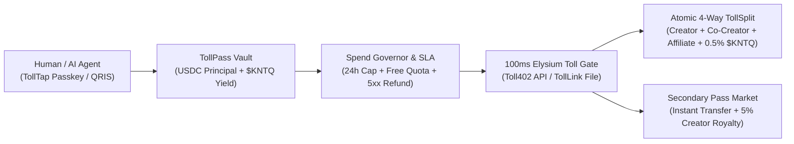

# Tollway — Universal 100ms Micro-Payment, Pay-to-Unlock & Self-Paying `$KNTQ` Yield Pass Protocol

[-10B981?style=flat-square)](https://github.com/Blanksite/tollway)
[-059669?style=flat-square)](https://github.com/Blanksite/tollway)
[-0C0E0D?style=flat-square)](https://github.com/Blanksite/tollway)
[](LICENSE)

> **Built for the Ascend Builder Incubator & Elysium L2 / Hyperliquid Ecosystem.**
>
> **Tollway** turns every API endpoint, AI agent tool (MCP), and digital file link into a **100ms electronic toll gate (E-ZPass / e-Toll for the internet)**—settled inline over Elysium L2 and powered by a **Self-Paying `$KNTQ` Yield Pass** where accrued Kinetiq staking yield automatically pays your daily micro-tolls before touching your principal.

---

## Why Tollway?

Traditional payment rails (Stripe's `$0.30 + 2.9%` fixed fee) make micro-transactions (`$0.001` to `$0.50`) economically impossible, forcing the entire internet into bloated `$20/month` SaaS subscriptions, intrusive ads, or risky manual OTC file escrow. Meanwhile, existing crypto payment flows require slow wallet popups, gas token management, and offer zero buyer protection when an API fails or a file is misrepresented.

**Tollway solves this with 7 unified protocol pillars built specifically for Elysium's 100ms block time and the Ascend / Kinetiq (`$KNTQ`) stack:**

| # | Pillar | What It Solves |
|---|---|---|
| **1** | **`Toll402` (API & AI Agent Gate)** | Native HTTP `402 Payment Required` (`x402`) reverse-proxy middleware. Monetize any REST route or MCP tool in 30 seconds (`$0.002/call`) with inline 100ms Elysium settlement. |
| **2** | **`TollLink` (No-Code Pay-to-Unlock & Rekber File Digital)** | *"WeTransfer + Instant Escrow"*. Upload any PDF, 3D model, dataset, or ZIP; buyers inspect a watermarked preview + SHA-256 fingerprint, pay `$0.25`, and unlock the original file + on-chain Commercial License Receipt in 100ms. |
| **3** | **`TollSplit` (Atomic 4-Way Revenue & Affiliate Splitter)** | Every micro-toll atomically splits in the same 100ms block across **Primary Creator**, **Co-Creator**, **Affiliate Referrer (`?ref=`)**, and **Ascend / `$KNTQ` Treasury (`0.5%`)**. |
| **4** | **`TollYield` (Self-Paying `$KNTQ` TollPass)** | Idle USDC in a user's `TollPass` is routed into **Kinetiq (`$KNTQ`)** yield strategies (`6.8% APY`). Micro-tolls deduct from accrued `$KNTQ` yield **first**, keeping principal intact, protected by an **On-Chain 24h Spend Governor & Boom Barrier Freeze**. |
| **5** | **`TollSLA` (Atomic Failure Refund)** | Trustless quality guarantee: if an upstream API times out (`>2,000ms`) or returns HTTP `5xx`, the toll is automatically refunded (`$0.0000` charged) in the same state transition. |
| **6** | **`TollTap` (Zero-Wallet Onboarding)** | Top up a `TollPass` in 3 seconds via **QRIS (Indonesian Rupiah via zkTLS proof)**, **FaceID Passkey (WebAuthn ERC-4337)**, or **Any-Chain USDC Auto-Bridge**. |
| **7** | **`TollRadar` + `Free-Quota` + `Resaleable Access Pass`** | Auto-grants first $N$ calls free per wallet (`Free-Quota`), routes AI agents to the cheapest/fastest verified gate (`TollRadar`), and lets users **resell unlocked dataset/file passes** at a discount with an automatic **5% creator royalty**. |

---

## System Architecture



---

## Repository Structure

```text
tollway/
├── contracts/
│   └── TollwayVault.sol         # Elysium L2 Solidity contract (TollPass, $KNTQ yield deduction, 4-way TollSplit, Resaleable Pass)
├── src/
│   └── app/
│       ├── api/
│       │   └── toll/
│       │       └── route.ts     # Live HTTP 402 (x402) Settlement Engine, SLA 502 Refund, Free-Quota & 4-Way Split API
│       ├── globals.css          # Editorial Financial Paper (#FAF9F6) & Precision Carbon (#0C0E0D) design tokens
│       ├── layout.tsx           # Root layout with Plus Jakarta Sans & JetBrains Mono typography
│       └── page.tsx             # Interactive 2-Column Tollway Workbench (Toll402, TollLink, TollRadar, Create Gate)
├── package.json
└── README.md
```

---

## Smart Contract Highlights (`contracts/TollwayVault.sol`)

- **`fundTollPass(uint256 amount)` & `creditYield(address holder, uint256 yieldAmount)`**: Separates user principal from accrued Kinetiq (`$KNTQ`) yield.
- **`passTollGate(bytes32 gateId, address affiliate)`**:
  1. Checks `frozen` circuit breaker and resets 24h window if elapsed.
  2. Checks per-user `freeQuotaCalls`—if under quota, emits `FreeQuotaUsed` and charges `0`.
  3. Deducts `tollFee` from `yieldAccrued` first (`Self-Paying TollPass`), only touching `principal` for any remainder.
  4. Executes an atomic 4-way split (`primaryBps`, `coCreatorBps`, `affiliateBps`, `PROTOCOL_FEE_BPS = 50`).
  5. Mints an on-chain `hasAccessPass[gateId][msg.sender]` receipt.
- **`resellAccessPass(bytes32 gateId, address seller, uint256 resalePrice)`**: Transfers access rights from `seller` to `msg.sender` while routing a **5% royalty (`500 bps`)** back to the original gate creator.

---

## Quick Start (Local Development)

```bash
# 1. Install dependencies
npm install

# 2. Start the development server on port 3008
npm run dev -- -p 3008

# 3. Build for production
npm run build
```

---

## License

Released under the [MIT License](LICENSE). Built by **Arief Noerhidayat** ([@Blanksite](https://github.com/Blanksite)) at **Rasabaik Studio** (`https://rasabaik.net`).
